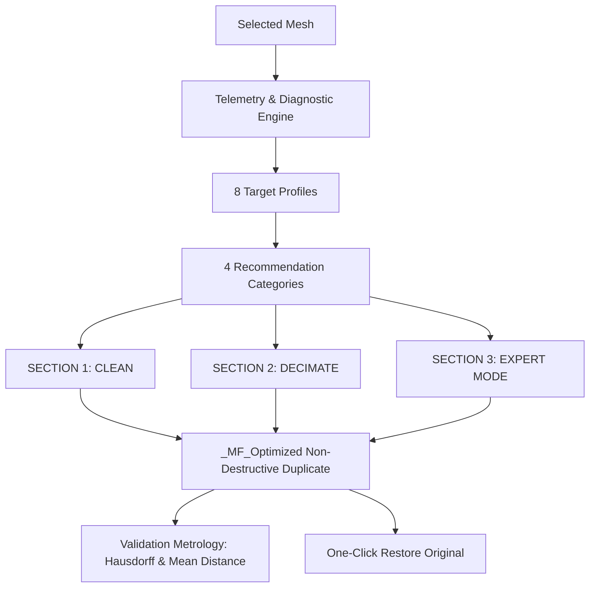

<div align="center">

# ⚡ MeshForge ⚡
### The Professional 3D Mesh Inspection, Repair & Decimation Suite for Blender & Maya

<br/>

<table>
  <tr>
    <td align="center" width="50%">
      <a href="https://github.com/shazamifius/meshforge/releases/latest/download/meshforge_blender.zip">
        
      </a>
      <br/><br/>
      <b>Compatible Blender 4.2 LTS / 5.2+ LTS</b><br/>
      <i>Direct 1-click download ready for Blender (Install from Disk)</i><br/>
      <code>Edit > Preferences > Add-ons > Install from Disk...</code>
    </td>
    <td align="center" width="50%">
      <a href="https://github.com/shazamifius/meshforge/releases/latest/download/meshforge_maya.zip">
        
      </a>
      <br/><br/>
      <b>Compatible Autodesk Maya 2020 through 2027+</b><br/>
      <i>Direct 1-click download with <code>install.mel</code> (Drag & Drop installer)</i><br/>
      <a href="https://github.com/shazamifius/meshforge/releases/latest/download/install.mel"><b>⚡ Or direct download install.mel only</b></a>
    </td>
  </tr>
</table>

<br/>

[](https://github.com/shazamifius/meshforge/releases/latest)
[](tests/test_runner.py)
[](meshforge_maya/tests/test_maya_runner.py)
[](MANUAL.md)

</div>

---

**MeshForge** is an advanced 3D mesh analysis, repair, geometric cleanup, and intelligent simplification suite available for both **Blender** and **Autodesk Maya**.

Engineered with an uncompromising **non-destructive architecture by default**, MeshForge strictly separates clean and decimation workflows, provides objective metrological surface verification, and guarantees transactional rollbacks on any invariant violation.

> 📖 **Documentation & Manuals:**  
> - **Exhaustive Manual (Blender & Maya):** [MANUAL.md](MANUAL.md) — Complete guide detailing 100% of the UX buttons, operators, algorithms, profiles, and workflows.
> - **Maya Add-on Guide:** [meshforge_maya/README.md](meshforge_maya/README.md) — Dedicated Maya installation and architecture guide.

---

## ⚡ Super Easy Installation in Fewest Clicks

### 🅰️ For Autodesk Maya (2020 through 2027+) — 1 Action
Choose either method below:
- **Option 1: Viewport Drag & Drop (Easiest — 0 Terminal!):**
  1. Open Maya.
  2. Drag and drop [**`install.mel`**](https://github.com/shazamifius/meshforge/releases/latest/download/install.mel) directly into Maya's 3D viewport.
  3. That's it! A **MeshForge** button is created on your shelf and the window opens automatically.
- **Option 2: 1-Click Installer (Outside Maya):**
  - **Windows:** Double-click `install_maya.bat`.
  - **macOS / Linux:** Run `./install_maya.sh`.
- **Option 3: Maya Python Script Editor:**
  ```python
  import sys; sys.path.insert(0, r"C:/path/to/meshforge"); import meshforge_maya; meshforge_maya.show()
  ```

### 🅱️ For Blender (4.2+ & 5.2+ LTS)
1. Download [**`meshforge_blender.zip`**](https://github.com/shazamifius/meshforge/releases/latest/download/meshforge_blender.zip).
2. In Blender, go to `Edit > Preferences > Add-ons > Install from Disk...` and select the downloaded `.zip`.
3. Enable **MeshForge** with the checkbox.
4. In the 3D Viewport, press `N` to open the sidebar tab **MeshForge**.

---

## 🎯 Supported DCC Platforms

| Platform | Location | Supported Versions | Operating Systems | UI Framework | Direct Download |
| :--- | :--- | :--- | :--- | :--- | :--- |
| **Blender** | Root (`core/`, `ui/`) | Blender 4.2 LTS to 5.2+ LTS | Windows, macOS, Linux | Native 3D Viewport N-Panel | [📦 Download Blender Addon (.zip)](https://github.com/shazamifius/meshforge/releases/latest/download/meshforge_blender.zip) |
| **Autodesk Maya** | `meshforge_maya/` | Maya 2020, 2022, 2023, 2024, 2025, 2026, 2027+ | Windows, macOS, Linux | Dockable PySide6 / PySide2 Window | [📦 Download Maya Script (.zip)](https://github.com/shazamifius/meshforge/releases/latest/download/meshforge_maya.zip) |

---

## 💎 100% Feature Parity Across DCCs

Both the Blender and Maya editions provide identical tools, data structures, and workflows:



1. **Non-Destructive Workflow:**
   - Source objects are kept 100% intact and safely hidden.
   - All operations execute on an independent duplicate: `[Name]_MF_Optimized`.
   - One-click **"Restore Original Mesh"** instantly reverts back to the original source.
2. **SECTION 1: CLEAN (Open by default):**
   - Non-destructive topological diagnosis (non-manifold geometry, zero-area faces, open boundaries, n-gons, sliver triangles, complex poles).
   - 8 Contextual Target Profiles (`GENERAL`, `GAME_ASSET`, `RENDER_ANIM`, `DEFORMABLE_CHAR`, `EXPORT_PREP`, `MECHANICAL_CAD`, `SCULPTED_ORGANIC`, `CUSTOM`).
   - The 4 Recommendation Categories: 1. Conservative Recommended Repairs, 2. Targeted Optimizations, 3. Risky Actions, 4. Informational Observations.
   - Direct Topology Tools: Cut N-Gons and Quadrangulate (Tris -> Quads).
3. **SECTION 2: DECIMATE (Collapsed by default):**
   - Edge collapse QEM vs. coplanar dissolve.
   - Dynamic live budget estimation before execution.
   - Detail preservation toggles (open boundaries, sharp/hard edges, UV texture seams).
   - Shape Key / BlendShape safety protection (creates static copy without corrupting character animation).
   - Metrological surface validation (Hausdorff max distance, mean surface deviation).
4. **SECTION 3: EXPERT MODE:**
   - Master sequential pipeline execution.
   - Dedicated specialist sub-panels (Repair, Manifold / Internal Walls, Dissolve, Simplification, Topology, Normals, Object Data).
   - Export structured reports as JSON or TXT.

---

## 🧪 Automated Headless Test Suites

### Blender Test Suite:
```powershell
& "C:\Program Files (x86)\Steam\steamapps\common\Blender\blender.exe" --factory-startup --background --python tests/test_runner.py
```

### Maya Test Suite (16/16 Tests PASS):
```powershell
& "C:\Program Files\Autodesk\Maya2027\bin\mayapy.exe" meshforge_maya/tests/test_maya_runner.py
```

---

## 📁 Repository Structure

```text
meshforge/
├── MANUAL.md                  # Comprehensive English manual for all features
├── README.md                  # Main project overview (Blender & Maya)
├── install.mel                # Maya drag-and-drop installer
├── install_maya.bat           # Windows 1-click double-click installer
├── install_maya.sh            # Unix/macOS 1-click installer
├── package_releases.py        # Automated release packager script
├── releases/                  # Prebuilt standalone zip archives
│   ├── meshforge_blender.zip  # Ready to install in Blender Preferences
│   └── meshforge_maya.zip     # Ready for Maya (drag & drop install.mel)
├── __init__.py                # Blender add-on entrypoint
├── core/                      # Blender core geometry & telemetry algorithms
├── ui/                        # Blender native UI layouts & operators
├── tests/                     # Blender automated tests
└── meshforge_maya/            # Autodesk Maya Add-on (1:1 Parity)
    ├── __init__.py            # Maya package entrypoint
    ├── install.py             # Shelf installer & drag-and-drop hook
    ├── install.mel            # MEL drag-and-drop installer
    ├── meshforge_maya.mod     # Maya module descriptor
    ├── icons/                 # Custom shelf icons (64x64, 32x32)
    ├── core/                  # Maya OpenMaya API 2.0 algorithms
    ├── ui/                    # PySide6/PySide2 dark themed interface
    └── tests/                 # Maya 16-test suite (mayapy)
```

---

## 📄 License

Distributed under the MIT License. Developed for technical artists, 3D modelers, and pipeline TDs.
